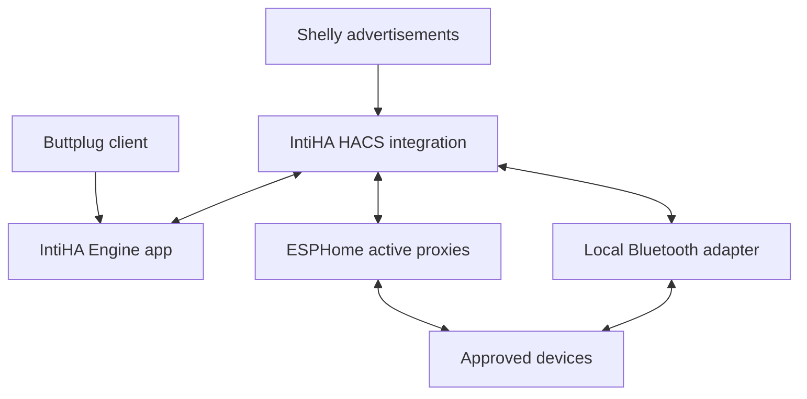

# IntiHA

**A local Buttplug server with Home Assistant Bluetooth coverage, device controls and diagnostics.**

IntiHA connects the official Rust Buttplug server to Home Assistant's Bluetooth
network. Install the **HACS integration and the IntiHA Engine app together**.
The app runs the device protocols; the integration owns the Bluetooth links,
Home Assistant entities and access to ESPHome proxies. A standalone container
can replace the app for Home Assistant Container installations.

**Release status: 0.1.0, initial release for hardware evaluation.** Software
tests use real Home Assistant and the official Buttplug engine with a simulated
radio. Physical devices, proxy firmware and room-to-room coverage still need
testing in your home. This is an independent project, not an official Intiface
or Home Assistant product.

## What it does

| Feature | Behaviour |
|---|---|
| Master enable switch | Turns device connections and control on/off. The integration itself remains loaded. |
| Search devices | Searches the shared HA advertisements for devices recognised by the upstream Buttplug profiles. |
| Approved devices | Only addresses you explicitly select can connect. Finding a device does not enrol it. |
| Automatic reconnect | Retries approved devices with bounded backoff. HA chooses an available connectable Bluetooth path on each fresh connection. |
| Buttplug server | Authenticated WebSocket endpoint using the official serializer and protocol engine, supporting negotiated specification versions 0–4. |
| HA controls | Vibration sliders for each advertised vibration feature, per-device stop, stop all and reconnect. Other supported actuator commands remain available through Buttplug clients. |
| Diagnostics | Engine status/address, client connection, control owner, device count, connectable-adapter count, device status, RSSI, last-seen time/source and last error. |
| Battery | Reported only where the upstream device profile supports battery reads. Unknown remains unknown. |
| Connection failures | Status changes without a failed integration setup. Requests are bounded and old movement commands are never replayed. |
| Stop fallback | HA retains the actual stop writes produced by the device's official driver and attempts them if the engine link fails. |

## Bluetooth hardware and moving between rooms

**ESPHome active Bluetooth proxies and supported local Bluetooth adapters can
control devices. Shelly Bluetooth proxies cannot carry active GATT connections.**
Shelly can contribute advertisements and presence information, but it cannot
relay the motor-control connection. Its “active scanning” option does not
change that limitation.



Bluetooth connections belong to one adapter at a time. Moving between rooms
may break a connection before a new one is established. IntiHA reconnects using
HA's available paths, starts the new connection stopped, and requires a new
control command. It does **not** promise uninterrupted handover or automatically
resume the previous motor setting. An external client must handle ordinary
Buttplug device removal/addition events and server reconnection. IntiHA ends
the old external controller session when a controllable device loses its BLE
link, preventing buffered commands from targeting a replacement connection.

For reliable coverage:

- Use ESP32 proxies with `bluetooth_proxy.active: true` and add them to HA's
  ESPHome integration. ESP8266 devices cannot act as BLE proxies.
- Put active proxies in the rooms you use, with overlapping coverage at the
  doorways. Avoid hiding them behind metal or placing them directly beside a
  busy Wi-Fi access point.
- Budget connection slots. ESPHome's default is three simultaneous active
  connections per proxy; other HA devices may already occupy some of them.
- Prefer Ethernet proxies where practical. ESPHome recommends up to four
  connections on Ethernet hardware, while larger counts may be unstable.
- Close the manufacturer's phone app or another controller if it is holding
  the device's only Bluetooth connection.

For an **existing, correctly configured ESP32 ESPHome device**, merge this
fragment with its configuration, without duplicating existing sections:

```yaml
esp32_ble_tracker:

bluetooth_proxy:
  active: true
```

“Last seen via” reports the source of an advertisement. It does not claim that
the active GATT connection uses that same proxy; HA also considers available
connection slots and failures when choosing a path. Use HA's Bluetooth panel
to inspect active connections.

## Installation on Home Assistant OS

Requirements: **Home Assistant 2026.10 or later**, HACS, an amd64 or aarch64 HA
OS host, and at least one connectable Bluetooth adapter/proxy. The initial test
baseline is **Home Assistant 2026.10.4 on Python 3.14.8**.

### 1. Install the engine app

1. Open **Settings → Apps → App store**. Older HA versions call Apps “Add-ons”.
2. Open the menu, choose **Repositories**, and add:

   ```text
   https://github.com/s2n2/IntiHA
   ```

3. Install **IntiHA Engine**. The app builds the pinned Rust source locally on
   first installation, which can take several minutes and substantial memory
   on smaller hosts.
4. In the app configuration, set two **different randomly generated tokens**:
   `bridge_token` for HA and `client_token` for Buttplug clients. Use 64 hex
   characters for each. A password manager can generate them, or run
   `openssl rand -hex 32` twice on a machine with OpenSSL.
5. Keep the default ports, **12345** for clients and **12346** for the HA bridge.
   Start the app and enable its watchdog. No host Bluetooth access or protection
   mode change is needed.

Both tokens must contain 32–256 visible ASCII characters without whitespace.
The app deliberately refuses empty, short or identical tokens. If using a
non-hex token in a URL, percent-encode it correctly.

### 2. Install the HA integration

1. In **HACS → menu → Custom repositories**, add the same repository URL with
   category **Integration**.
2. Install **IntiHA**, and restart Home Assistant when HACS requests it.
3. Open **Settings → Devices & services → Add integration → IntiHA**.
4. Enter the engine bridge URL, replacing the address with your HA host:

   ```text
   ws://192.168.0.10:12346/bridge
   ```

5. Enter the app's **bridge token**. Do not append a token to this URL.

The integration can be configured while the engine is offline. Its connection
sensor will show the actual state and the background connection will retry.
It starts with the master switch **off**.

### 3. Select your devices

1. Put a device into its normal Bluetooth advertising/pairing mode.
2. Open the **IntiHA** device in HA and turn **Enabled** on.
3. Press **Search devices**. The default search lasts 30 seconds.
4. Open the integration's **Configure → Choose devices** options and select the
   devices you want to approve. You can also enter known Bluetooth MAC addresses.
5. Save. The integration reloads and connects approved devices when visible.
6. Device entities appear under the integration. Vibration controls are created
   after the engine identifies the device's capabilities and confirms its stop
   plan is stored in HA.

Use **Configure → Reconnect and timeouts** to change automatic reconnect,
search duration (5–120 seconds) and the HA manual-control timeout (15–600
seconds, default 60). The timeout stops manual output if no new movement
command arrives. It is not a timer that resumes a pattern.

If an options change reloads the integration or HA restarts, the requested
master on/off state is retained. Connections can return automatically, but
movement values are never restored.

### 4. Connect a Buttplug client

Give a client that accepts a full server URL:

```text
ws://192.168.0.10:12345/?token=YOUR_CLIENT_TOKEN
```

The server also accepts an HTTP `Authorization: Bearer ...` header from
clients that support it. Clients with a fixed host/port field and no full URL
or header support may need a compatible authenticated connector. Do not use
the bridge token as the client token.

Only one external controller is accepted at a time. It owns movement control
while connected; HA's sliders become unavailable, while HA can still read
status and issue a stop. External clients negotiate the official 20-second
Buttplug ping deadline. Client loss, missed pings, disabling IntiHA and ownership
changes trigger stop attempts and clear cached output values.

Stops deliberately release the old Bluetooth link after applying its cached
stop plan. This fences out any movement already queued on that link. With
automatic reconnect enabled, the device reconnects stopped after a short
pause. With it disabled, press Search to reconnect. HA's Stop all also ends
the current external control session; reconnect the client if you want to
start a new session. Feature-specific v4 stop requests conservatively stop
the whole device. A stop or link loss affecting a controllable device can end
the external controller session even when other devices remain in range.

Some browser-based clients served over HTTPS reject a remote `ws://` connection
as mixed content. Use a trusted `wss://` reverse proxy or a supported local
connector for those clients. Keep both endpoints on your trusted LAN; tokens
provide authentication but ordinary `ws://` does not encrypt traffic.

## Home Assistant controls and automations

The integration creates one hub device and one device per selected address.
Entity IDs depend on your HA naming and any names you change. Use the entity
picker rather than assuming the IDs below are exact.

| Entity/control | Meaning |
|---|---|
| Enabled | Requested master state. It remains usable while the engine is offline. |
| Status | Disabled, connecting, ready, or stop unconfirmed. “Ready” describes the bridge, not every device. |
| Engine connected | Authenticated engine bridge connection established. |
| Engine address | Configured engine host/IP, with no credentials. |
| Connected devices | Identified devices with an installed stop plan. |
| Active Bluetooth adapters | Connectable scanners, including local adapters and active proxies. This is not a free-slot count. |
| Device connected | The official engine has identified the live device and installed its stop plan. |
| Vibration 1, 2, … | Last successful HA command in percent. This is **not physical speed feedback**. |
| Battery | Battery reading if the profile exposes it. Unsupported or disconnected readings remain unknown. |
| Stop unconfirmed | A stop failed or could not be confirmed; check the physical device. |

Actions are also available in **Developer tools → Actions**:

```yaml
action: intiha.stop_all
```

```yaml
action: intiha.scan
```

```yaml
action: intiha.reconnect
```

Each accepts an optional `entry_id`. The integration intentionally permits only
one IntiHA entry per HA instance.

## Reliability boundaries and device compatibility

IntiHA uses the upstream BLE device profiles and protocol handlers. It does
not claim that every device supported by desktop Intiface works through every
ESPHome proxy. BLE pairing/bonding, proprietary authentication, long packets,
unusual notification behaviour and device firmware can limit compatibility.
USB, serial, HID and network-only devices are outside this BLE bridge.

The initial HA controls cover vibration. Rotation, linear and other supported
upstream commands remain available to compatible external Buttplug clients.
Native manufacturer patterns are not exposed by this release; it does not
invent a generic pattern list across different We-Vibe protocols.

The classic upstream We-Vibe initialiser briefly requests a non-zero motor
level before stopping. IntiHA replaces **only that exact first classic We-Vibe
packet** with its documented stop packet. This exception is covered by software
tests and still needs confirmation on each physical model. It does not change
normal user-issued commands or claim identical behaviour for Chorus, Vector,
Moxie or other protocol families.

No software can deliver a stop through a Bluetooth link that has already
failed. A device may retain its last setting until its own firmware stops it
or the connection recovers. Keep its physical stop/power control accessible.
The stop-plan fallback is best effort, not a physical safety guarantee.

## Home Assistant Container

Install the same custom integration through HACS or copy
`custom_components/intiha` into your HA configuration. Build/run the engine
using [engine/compose.yaml](engine/compose.yaml). Set its two tokens in an
uncommitted `.env` file and point the integration at that container's reachable
host address. The engine needs network access to HA's bridge connection, not
direct access to the host Bluetooth adapter.

See [engine/DOCS.md](engine/DOCS.md) for app/container details and
[engine/BRIDGE_PROTOCOL.md](engine/BRIDGE_PROTOCOL.md) for the wire protocol.

## Troubleshooting

| Symptom | Check |
|---|---|
| Integration loaded, engine disconnected | App running, host address, port 12346, matching bridge token and network reachability. |
| Authentication failed | Use the bridge token in HA and the separate client token for the client. |
| Shelly sees the device but it will not connect | Add an active ESPHome proxy or local adapter in that area. |
| Device does not appear in search | Advertise/pair the device, close its phone app, enable IntiHA and search again. Unsupported upstream BLE profiles are ignored. |
| Device selected but offline | Power/advertising, active proxy coverage, free connection slots and any competing Bluetooth connection. |
| Stops after a minute with HA sliders | The default manual-control timeout is 60 seconds. Adjust it in options if needed. |
| HA sliders unavailable | Device offline, stop plan not yet ready, master off, or an external client owns control. |
| Battery unknown | The device profile may not expose battery reads; IntiHA does not estimate it. |
| Break when moving rooms | BLE must reconnect. Improve overlapping active-proxy coverage and check the client's device-reconnect handling. |
| App restarts repeatedly | Validate two distinct tokens, inspect app logs, and check that ports are free. |

Diagnostics downloaded from the HA integration omit tokens, engine host,
Bluetooth addresses, device names and output values. Avoid posting complete
client URLs, configuration files or activity histories in public issues.

## Development and verification

```bash
uv venv --python 3.14.8 .venv
uv pip install --python .venv/bin/python -r requirements-dev.txt
.venv/bin/pytest
.venv/bin/ruff check custom_components tests
.venv/bin/ruff format --check custom_components tests
```

```bash
cd engine
cargo test --locked --all-targets
cargo clippy --locked --all-targets -- -D warnings
cargo fmt --all -- --check
```

The test suite covers genuine HA setup/entity lifecycle, option validation,
authentication/session isolation, bounded BLE operations, stop ordering,
cancelled connects, stale-generation callbacks, timeout cleanup, upstream
We-Vibe translation and client ownership. The combined system test runs the
compiled engine with the real HA bridge and a simulated BLE radio.

GitHub Actions runs Python/Rust validation, HACS/hassfest checks and native
amd64/aarch64 app image builds. Version-tagged releases produce a draft release
after those checks. See [docs/HARDWARE_TESTING.md](docs/HARDWARE_TESTING.md) for
the physical acceptance procedure before relying on unattended behaviour.

## Upstream references

- [Home Assistant Bluetooth support and proxy capabilities](https://www.home-assistant.io/integrations/bluetooth/)
- [Home Assistant Bluetooth developer API](https://developers.home-assistant.io/docs/bluetooth/)
- [Shelly Bluetooth limitations](https://www.home-assistant.io/integrations/shelly/#bluetooth-support)
- [ESPHome Bluetooth proxy configuration and connection limits](https://esphome.io/components/bluetooth_proxy/)
- [Buttplug source and device profiles](https://github.com/buttplugio/buttplug)
- [Buttplug protocol specification](https://buttplug.io/docs/spec/)
- [We-Vibe protocol documentation](https://buttplug.io/stpihkal/protocols/we-vibe/)
- [Buttplug ping and its limitations](https://buttplug.io/docs/dev-guide/cookbook/connections/ping/)

IntiHA is BSD-3-Clause licensed. Buttplug is copyright Nonpolynomial Labs LLC
and contributors and is also BSD-3-Clause licensed. See
[THIRD_PARTY_NOTICES.md](THIRD_PARTY_NOTICES.md).
