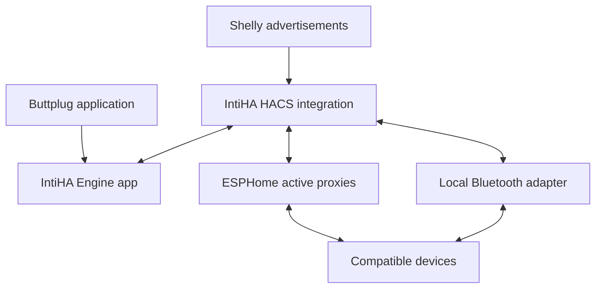

# IntiHA

> **0.3.0b14 proxy-native beta:** This build is for installations that use Home Assistant managed Bluetooth / ESPHome active proxies and have **no local Bluetooth adapter**. It does not require BlueZ, D-Bus, `btleplug`, or a USB Bluetooth dongle.


**A plug-and-play Buttplug server using Home Assistant's Bluetooth coverage.**

Start the engine, add the discovered integration, and turn on a compatible
Bluetooth device. IntiHA passes BLE advertisements from Home Assistant to the
official Buttplug device manager, which performs the normal Intiface protocol
matching and creates controls for supported devices. There are **no IntiHA
tokens, required device approval lists, manually entered MAC addresses or required search steps**.

Install the **HACS integration and IntiHA Proxy Engine together**. Home
Assistant owns BLE scanning, adapter selection and GATT through its connectable
adapters and ESPHome proxies. The Rust engine owns Buttplug protocol matching,
device drivers and the external Buttplug server.

**Version 0.3.0b14 - proxy recovery and clearer connection diagnostics beta.**

0.3.0b9 keeps the broad/service-fingerprint discovery from 0.3.0b6 and the persistent identity fixes from b8. The Engine app is now distributed as a prebuilt multi-architecture GHCR image, so Home Assistant updates pull the finished image instead of compiling Rust locally at 0% progress. Device identity remains persistent. IntiHA now remembers the best specific name it has learned for each Bluetooth address, actively asks Home Assistant for scan-response names when a supported device is otherwise generic, and can recover the standard BLE Device Name after connection. A later generic Buttplug label can no longer downgrade a learned name such as **Bond**. Each discovered device retains the persistent **Connect to this device** switch introduced in b7.

0.3.0b14 adds per-device retry cooldowns for unavailable ESPHome proxy slots and BLE connection timeouts, plus more informative device statuses. It retains the b11 engine behaviour and existing safety safeguards; the earlier pulse restart issue remains under investigation. The hub exposes separate **Currently connected** and **Disconnected devices** summaries.

The Home Assistant **Server enabled** switch gates the complete user-facing
Intiface service. When it is off, IntiHA stops outputs, discovery and BLE
sessions, invalidates any external controller, and rejects new Buttplug
WebSocket connections. The private Home Assistant bridge remains connected
only so the same switch can turn the server back on.

This release removes IntiHA's exact protocol pre-filter. Every valid BLE
candidate is handed to Buttplug's upstream matcher, so Intiface-supported BLE
devices are no longer limited to the subset IntiHA happened to recognise in
advance. A device is only exposed to Home Assistant after Buttplug accepts it
as a viable protocol.

External clients now take control only after a valid Buttplug handshake. On
takeover, timeout or disconnect, IntiHA sends the already verified stop plan
while retaining a healthy BLE session instead of tearing it down and forcing a
full reconnect. Hard stop/off/shutdown paths still disconnect where safety
requires it.

The proxy transport is BLE-only: Intiface hardware that needs a USB serial,
HID, gamepad or other non-BLE hardware manager cannot be carried through an
ESPHome Bluetooth proxy.

This is an independent project, not an official Intiface or Home Assistant
product.

## Version history

HACS shows this README on the integration's information page. The full history
is in [CHANGELOG.md](CHANGELOG.md); published updates also show the matching
[GitHub release notes](https://github.com/s2n2/IntiHA/releases).

| Version | What changed |
|---|---|
| **0.3.0b14** | External-client stop barrier: clear Buttplug output/keepalive state, cancel stale queued writes, send verified BLE stop last; add connected/disconnected summaries. |
| **0.3.0b9** | Pull a prebuilt multi-arch Engine image instead of compiling Rust locally during HA updates; retain persistent best-known names, active-scan/GATT name recovery and per-device connection policy. |
| **0.3.0b6** | Service-fingerprint discovery for nameless BLE devices; post-connect GATT validation remains mandatory. |
| **0.3.0b5** | Build repair for 0.3.0b4: valid Cargo SemVer internally (`0.3.0-b5`) while IntiHA/HA report `0.3.0b5`; master-switch behaviour unchanged. |
| **0.3.0b4** | Master-switch build: Off rejects external clients and tears down BLE/discovery while retaining only the HA control bridge. Superseded because its Cargo package version was invalid. |
| **0.3.0b3** | Forward all HA BLE candidates to Buttplug's official matcher; external clients can command existing proxy sessions and release control without forcing a BLE reconnect. |
| **0.3.0b2** | Restore the Home Assistant / ESPHome proxy transport as the production backend; no local Bluetooth adapter required. |
| **0.3.0b1** | Native-engine experiment requiring a local Bluetooth adapter; superseded for proxy-only installations. |
| **0.2.7** | Request BLE pairing for identified Bond / learned ATT security requirements; prevent the hidden nine-attempt retry loop; retain verified stops and no command replay. HACS-only runtime update. |
| **0.2.6** | Remove automatic Bluetooth scan sweeps introduced in 0.2.5; retain manual Search and automatic advertisement discovery; improve scan deduplication. HACS only. |
| **0.2.5** | Make Search perform an actual HA Bluetooth active sweep; add bounded periodic discovery for devices not visible from passive advertisements. HACS-only runtime change; the 0.2.4 Engine is compatible. |
| **0.2.4** | Separate driver stop-packet generation from real GATT verification; atomic write-and-cache acknowledgement; serialised connection attempts; useful connection-stage diagnostics. Update both HACS and the Engine app. |
| **0.2.3** | Restore control for verified classic We-Vibe devices when the upstream stopped-state command produces no Bluetooth writes; retain stop-on-disconnect and add detailed diagnostics. |
| **0.2.2** | Fix Docker installation without relying on a separately published `engine/licenses/` folder; collect upstream dependency licences during the Rust build. |
| **0.2.1** | Fix IntiHA Engine app installation by including the full dependency-licence directory in the GitHub repository; add release-history visibility and build checks. No configuration changes. |
| **0.2.0** | Plug-and-play setup: no tokens or device approval, automatic compatible-device connection, discovery, dynamic controls, and safer reconnect handling. |
| **0.1.0** | Initial engine, HACS integration, sensors, Bluetooth proxy support, stops and manual control. |

## Updating to 0.3.0b14

Update **both** the IntiHA HACS integration and **IntiHA Proxy Engine** to
0.3.0b14. Before the first update from 0.3.0b6, turn **Server enabled** off and
wait for Connected devices to reach 0; this avoids the old b6 shutdown path
being held by a live BLE operation. Then update the Engine app and restart Home
Assistant. **For b10, wait for the GitHub Action `Publish IntiHA app image` to finish successfully before pressing Update in Home Assistant.** Supervisor now pulls that prebuilt image instead of compiling the Rust engine locally. From b7 onward shutdown is bounded so Supervisor updates cannot wait indefinitely. Do not run the native-only 0.3.0b1 app alongside the Proxy Engine.
No Bluetooth dongle is required.

After restart, the IntiHA device should report **Bluetooth transport: Home
Assistant Bluetooth / ESPHome proxies**. Existing ESPHome proxies only need to
be connectable (`bluetooth_proxy: active: true`) with a free connection slot.

Discovery is intentionally broad in this release. IntiHA forwards valid BLE
advertisements to Buttplug and lets its official device configuration decide
whether a peripheral is supported. Devices that Buttplug rejects do not become
IntiHA devices. Every IntiHA device has a **Connect to this device** switch,
on by default. Turning it off keeps the device/entities visible but suppresses
future connection and retry attempts until the switch is turned on again.

External Buttplug clients still use the normal IntiHA WebSocket endpoint. A
valid client handshake transfers control from Home Assistant; releasing the
client sends a verified stop but retains healthy BLE links so the next
controller does not need to rediscover and reconnect the hardware.

## Updating from 0.2.5

Install **IntiHA 0.2.6** through HACS and restart Home Assistant. The
**IntiHA Engine app does not need an update**, and can remain on 0.2.4 or
0.2.5. Engine protocol and Bluetooth stop handling are unchanged. Normal
advertisements still discover supported devices automatically. If a device
needs an active scan to reveal its services or name, use **Search devices**;
IntiHA will not run active sweeps automatically while trying to establish
continuous GATT connections.

If all IntiHA controls and diagnostics show **unavailable**, first check
Settings > Devices & services > IntiHA and Home Assistant **Core** logs for a
config-entry or platform exception. Engine BLE errors alone should not make
master controls unavailable. Only then investigate Bluetooth transport.

## Updating from 0.2.4

Install the **0.2.5 HACS integration** and restart Home Assistant. The Engine
may remain on 0.2.4; its bridge protocol has not changed. The repo also bumps
Engine packaging metadata to 0.2.5 for a consistent GitHub release, but
rebuilding the Engine is **not required** for this discovery hotfix. Search
now starts a real active sweep through Home Assistant's existing adapters.
If a peripheral still does not appear, check whether it advertises in the
Bluetooth network map and whether Buttplug supports its protocol. Discovery
and connection are separate operations.

## Updating from 0.2.3

Stop the Engine app first. Update the HACS integration to **0.2.4** and restart
Home Assistant, then update/rebuild and start **IntiHA Engine 0.2.4**. A new
`prepare_stop` bridge operation requires both components; updating the app
alone is insufficient. No ESPHome, Wi-Fi, token or device-selection changes
are required. The update does not remove existing device entities.

## Quick setup on Home Assistant OS

Requirements: Home Assistant **2026.10 or later**, HACS, an **amd64 or aarch64**
HA OS host, and an active ESPHome Bluetooth proxy or supported local adapter.

1. In **HACS → Custom repositories**, add
   `https://github.com/s2n2/IntiHA` as an **Integration**. Install IntiHA and
   restart Home Assistant.
2. Add the same repository under **Settings → Apps → App store → Repositories**.
   Install **IntiHA Engine** and press **Start**. Keep the defaults; there are
   no credentials to create or copy. Enable Start on boot and Watchdog if
   desired. The Engine is pulled as a prebuilt amd64/aarch64 container, so Home Assistant does not compile Rust during install/update.
3. Open **Settings → Devices & services** and accept the discovered **IntiHA**
   integration. Its confirmation has no configuration fields. If you use
   **Add integration → IntiHA** instead, it also checks for the running app.
4. Turn on a supported Bluetooth device in its normal connection mode.
   IntiHA connects it automatically and adds its controls and status sensors.

A new installation starts enabled, with automatic reconnection on. The master
switch remembers your choice across restarts. A device powered on later is
also found automatically; you do not have to reload the integration.

If the app cannot be discovered, the fallback setup asks only for the engine
host, such as `192.168.0.10`. A full bridge URL such as
`ws://192.168.0.10:12346/bridge` also works. Setup remains available while the
engine is offline and retries the connection in the background.


### GitHub Container Registry image

The Engine app uses `ghcr.io/s2n2/intiha-engine:<version>`. The `Publish IntiHA app image` GitHub Action builds native amd64 and aarch64 images and publishes a multi-architecture manifest whenever Engine files are pushed to `main`. The GHCR package must be publicly readable for Home Assistant Supervisor to pull it without registry credentials. If a first install reports `unauthorized` or `denied`, open the `intiha-engine` package in GitHub and set its visibility to **Public**, then retry the update.

### Connect a Buttplug application

Use the Home Assistant machine's IP address:

```text
ws://192.168.0.10:12345
```

For applications with separate fields, enter the same IP and port **12345**.
No token, query parameter or custom header is needed. The client and bridge
ports accept connections without authentication on your local network.

The server uses the official Buttplug serializer and protocol engine,
negotiating protocol versions 0–4. One external application controls devices
at a time. While it is connected, HA movement sliders are unavailable;
HA status and stop controls remain available. Disconnect the application to
return control to Home Assistant.

## What happens automatically

| Feature | Behaviour |
|---|---|
| Engine discovery | The HA app announces its internal address through Supervisor; accept one confirmation in HA. |
| Device discovery | Continuous use of HA's shared Bluetooth advertisements while enabled. The official Buttplug profiles identify compatible devices. |
| Device connection | Every recognised compatible device is connected when an active Bluetooth path and a connection slot are available. |
| HA entities | Device status, stop button and sensors appear on discovery; supported vibration controls appear after identification. No reload is needed. |
| Reconnection | Failed links are retried with bounded backoff. HA chooses an available connectable path for each new link. |
| Restart | Remembered device entities and the master on/off preference return. Motor levels are never restored. |
| Device names | Actual device names from the engine, with any custom HA name preserved. |
| Unsupported peripherals | Ignored by the upstream device matcher; IntiHA does not connect to every Bluetooth peripheral. |

**Search devices** remains available as a refresh/retry button. Normal
discovery continues without it. If you disable automatic reconnection in
options, newly found devices still connect once; Search explicitly retries
previously attempted devices.

## Controls, sensors and optional settings

The integration creates an IntiHA hub device and a device for each recognised
Bluetooth address. Device identities are stable when the Bluetooth path
changes. Entity IDs depend on HA naming and any changes you make.

| Control or sensor | Meaning |
|---|---|
| Enabled | Master on/off; available even while the engine is offline. Turning it off stops and disconnects owned devices. |
| Search devices | Refresh discovery and retry available devices now. |
| Reconnect | Start a fresh engine session and refresh Bluetooth routing. |
| Stop all / device stop | Attempt the driver's stop commands, clear old commands and release the affected links. |
| Vibration 1, 2, … | Percent command for each supported vibration feature. The value is the last HA command, not measured motor speed. |
| Status / engine connected | Disabled, connecting, ready or stop unconfirmed; ready describes the bridge, not every device. |
| Client connected / control owner | Whether an external Buttplug application owns movement control. |
| Connected devices | Devices identified and ready for control, with stop plans installed. |
| Active Bluetooth adapters | Connectable HA scanners, including active proxies and local adapters. This is not a free-slot count. |
| Device connected / device status | Whether controls are ready, plus connecting, initialising, verifying stop, retrying or offline stages. The status attributes retain the last error. |
| Battery | Actual reading where the upstream profile supports it; otherwise unknown. |
| Signal strength / last seen / last seen via | Latest advertisement information. The advertisement source is not necessarily the active control path. |
| Stop unconfirmed / last error | A failure or uncertain stop remains visible instead of being reported as success. |

The defaults need no adjustment. Optional settings are under **Configure →
Reconnect and timeouts**: automatic reconnect, explicit search duration
(5–120 seconds, default 30) and the HA manual-control timeout (15–600 seconds,
default 60). The timeout stops manual output when no new movement command
arrives. The engine address can also be changed under Configure.

Actions are available in **Developer tools → Actions**:

```yaml
action: intiha.stop_all
```

```yaml
action: intiha.scan
```

```yaml
action: intiha.reconnect
```

Each accepts an optional `entry_id`. One IntiHA entry is supported per HA
instance.

## Bluetooth coverage and moving between rooms

**Active ESPHome Bluetooth proxies and supported local adapters can control
devices. Shelly Bluetooth proxies provide advertisements only; they cannot
carry the active GATT control connection.** Shelly's active-scanning setting
does not change that limitation. See the
[HA Bluetooth documentation](https://www.home-assistant.io/integrations/bluetooth/),
[Shelly documentation](https://www.home-assistant.io/integrations/shelly/#bluetooth-support)
and [ESPHome proxy guide](https://esphome.io/components/bluetooth_proxy/).



Use active proxies in the rooms you use, with overlapping coverage between
rooms and available connection slots. ESPHome defaults to three active
connections per proxy, shared with other HA devices. Ethernet proxies can
reduce Wi-Fi/Bluetooth contention. Avoid obstructing antennas with metal.

For an existing supported ESP32 device, merge this into its ESPHome
configuration without duplicating existing sections:

```yaml
esp32_ble_tracker:

bluetooth_proxy:
  active: true
```

A working Bluetooth connection stays on its current adapter. If the link
breaks while you move, IntiHA establishes a fresh connection through HA's
available paths. A healthy connection resets retry backoff so earlier room
changes do not cause increasingly long reconnect delays. Radio recovery
still depends on advertisements, coverage and free proxy slots.

Reconnection starts stopped and waits for a fresh command. IntiHA cannot
provide uninterrupted Bluetooth handover. It ends the external control
session when a ready device's link is lost, preventing old buffered commands
from reaching a replacement connection. The client must support reconnecting
to the server and ordinary device removal/addition.

## Stop handling and device compatibility

HA caches the actual stop writes produced by the official device driver
before enabling controls. If the engine disappears, HA attempts these cached
writes and disconnects. Explicit stop also closes the old Bluetooth link to
prevent queued movement reaching it. With automatic reconnect enabled, the
device returns stopped after a short pause. HA Stop all ends the current
external control session; reconnect the client for a new session.

The classic upstream We-Vibe initializer briefly requests a non-zero motor
level before stopping. IntiHA replaces only that exact first classic We-Vibe
packet with its stop packet. The exception is tested in software and still
needs confirmation on actual models. It does not change user commands or
claim identical behaviour for other We-Vibe protocol families.

IntiHA uses upstream BLE profiles. Some devices supported by desktop Intiface
may require pairing, bonding or Bluetooth features unavailable through a
particular proxy. USB, serial, HID and network-only devices are outside this
BLE bridge. HA provides vibration sliders; other actuator types supported by
the official engine remain available to Buttplug applications. Native vendor
pattern lists are not added by this release.

A stop cannot be delivered through an already broken radio link. A failed
stop remains visible, and a fresh connection must be ready and stopped before
control resumes. Physical device and room testing are documented in
[docs/HARDWARE_TESTING.md](docs/HARDWARE_TESTING.md).

## Home Assistant Container

Install the same integration through HACS or copy `custom_components/intiha`
into your HA configuration. On the Docker host:

```sh
cd engine
docker compose up -d --build
```

No `.env` file or secrets are needed. Add the integration using the Docker
host's IP address. Clients use `ws://DOCKER_HOST_IP:12345`. The container uses
HA's Bluetooth transport and needs no direct host Bluetooth access.

See [engine/DOCS.md](engine/DOCS.md) for app/container details and
[engine/BRIDGE_PROTOCOL.md](engine/BRIDGE_PROTOCOL.md) for the wire protocol.

## Upgrading from 0.1.0

Update both the integration and engine to 0.2.0. The HA configuration migration
removes obsolete credentials and selected-device settings. Saved device
metadata, useful connection/reconnect settings and the master on/off choice
are retained. Change existing client URLs to the plain address above. No
replacement credentials or device-selection step is needed.

## Troubleshooting

| Symptom | Check |
|---|---|
| No discovered integration card | Install the integration first and restart HA, then start the engine app. Manual Add also checks Supervisor announcements; host entry is the fallback. |
| Integration loaded, engine disconnected | App running and reachable bridge address/port 12346. |
| Shelly sees a device but it cannot connect | Add an active ESPHome proxy or local adapter in that area. |
| Device does not connect automatically | Device on and advertising, IntiHA enabled, supported upstream profile, active proxy in range and a free slot. Close any phone app already holding its Bluetooth connection. |
| Stops after a minute with HA sliders | Default manual-control timeout is 60 seconds; adjust in options if needed. |
| HA sliders unavailable | Device offline/not yet ready, master off, or an external application currently owns control. |
| Battery unknown | Upstream profile may not provide a battery read. |
| Pause when changing rooms | Bluetooth needs a fresh connection. Check overlapping active-proxy coverage and client reconnect support. |
| App fails to start | Inspect app logs and check that the mapped ports are free. |
| Browser application cannot connect | Some HTTPS pages block remote plain WebSockets. Use a client-supported local connector or a correctly configured `wss://` endpoint. |

Downloaded diagnostics omit engine host, Bluetooth addresses, device names
and output values.

## Development and verification

```sh
uv venv --python 3.14.8 .venv
uv pip install --python .venv/bin/python -r requirements-dev.txt
cargo build --locked --manifest-path engine/Cargo.toml
INTIHA_REQUIRE_SYSTEM_TESTS=1 .venv/bin/pytest
.venv/bin/ruff check custom_components tests
.venv/bin/ruff format --check custom_components tests
cargo test --locked --manifest-path engine/Cargo.toml --all-targets
cargo clippy --locked --manifest-path engine/Cargo.toml --all-targets -- -D warnings
cargo fmt --manifest-path engine/Cargo.toml --all -- --check
```

Tests exercise automatic discovery, dynamic HA entities, tokenless client
connections, startup and shutdown, stop ordering, failed operations, bounded
requests, stale commands, upstream protocol translation and controller
ownership. Cross-process tests run the compiled engine with real Home
Assistant and a simulated radio. See [docs/VALIDATION.md](docs/VALIDATION.md)
for executed checks and their limits.

GitHub Actions also validates HACS/hassfest metadata and builds native amd64
and aarch64 app images. Version tags prepare draft releases after validation.
See [docs/PUBLISHING.md](docs/PUBLISHING.md) for publishing the source archive.

## Upstream references

- [HA Bluetooth developer API](https://developers.home-assistant.io/docs/bluetooth/)
- [Supervisor app discovery](https://contributors.home-assistant.io/apps/supervisor-api/services/)
- [Buttplug source and device profiles](https://github.com/buttplugio/buttplug)
- [Buttplug protocol specification](https://buttplug.io/docs/spec/)
- [We-Vibe protocol documentation](https://buttplug.io/stpihkal/protocols/we-vibe/)
- [Buttplug ping](https://buttplug.io/docs/dev-guide/cookbook/connections/ping/)

IntiHA is BSD-3-Clause licensed. Buttplug is copyright Nonpolynomial Labs LLC
and contributors and is also BSD-3-Clause licensed. See
[THIRD_PARTY_NOTICES.md](THIRD_PARTY_NOTICES.md).

### Device grouping (b13)

IntiHA keeps three live, exclusive groups: **Currently connected**, **Known, not connected**, and **Connection disabled** (when **Connect to this device** is switched off). Each device receives a matching Home Assistant label, so you can filter the Devices page by label. The IntiHA hub also exposes a count and `devices` attribute for each group, suitable for dashboards. Home Assistant's built-in integration device-list section heading cannot be customised by an integration, so the native list remains a single list.

### b14 known-device reconnection

When the engine is on and auto-reconnect is enabled, advertisements from previously recognised, connection-enabled devices are prioritised ahead of newly discovered peripherals. This works when a powered-off device starts advertising again or when a device drops and becomes reachable by a different ESPHome proxy. BLE does not roam seamlessly, and no connection is possible while all suitable proxies are unavailable. Existing retry backoffs are not cleared by inventory changes. Device output remains stopped after any reconnection.
