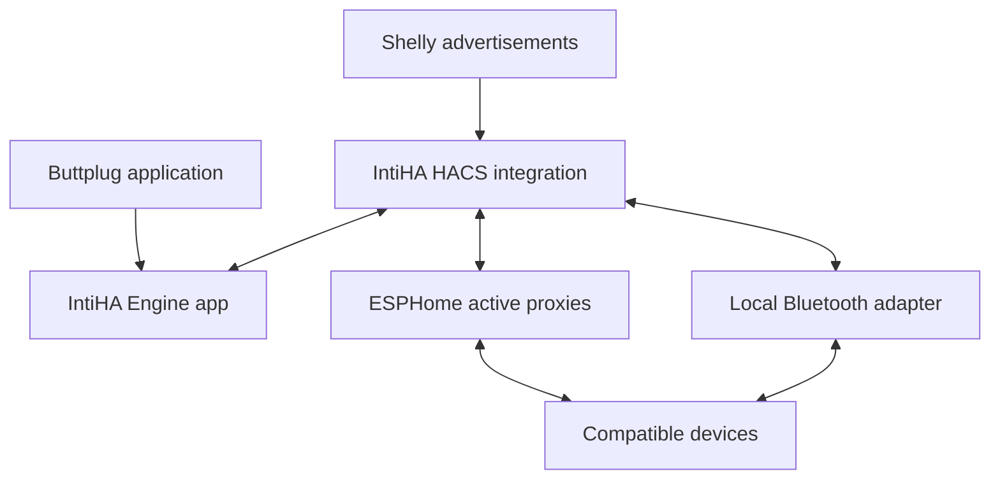

# IntiHA

**A plug-and-play Buttplug server using Home Assistant's Bluetooth coverage.**

Start the engine, add the discovered integration, and turn on a compatible
Bluetooth device. IntiHA finds it, connects it and creates its Home Assistant
controls automatically. There are **no IntiHA tokens, device approval lists,
MAC addresses or required search steps**.

Install the **HACS integration and IntiHA Engine app together**. The app runs
the official Rust Buttplug server and device protocols. The integration
connects them to Home Assistant's Bluetooth network and provides the HA
controls and sensors. Home Assistant Container users can run the same engine
with Docker Compose.

**Version 0.2.1 — ready for physical hardware evaluation.** Automated tests
use real Home Assistant and the official Buttplug engine with a simulated
radio. Actual devices and room-to-room radio coverage still require testing.
This is an independent project, not an official Intiface or Home Assistant
product.

## Version history

HACS shows this README on the integration's information page. The full history
is in [CHANGELOG.md](CHANGELOG.md); published updates also show the matching
[GitHub release notes](https://github.com/s2n2/IntiHA/releases).

| Version | What changed |
|---|---|
| **0.2.1** | Fix IntiHA Engine app installation by including the full dependency-licence directory in the GitHub repository; add release-history visibility and build checks. No configuration changes. |
| **0.2.0** | Plug-and-play setup: no tokens or device approval, automatic compatible-device connection, discovery, dynamic controls, and safer reconnect handling. |
| **0.1.0** | Initial engine, HACS integration, sensors, Bluetooth proxy support, stops and manual control. |

## Quick setup on Home Assistant OS

Requirements: Home Assistant **2026.10 or later**, HACS, an **amd64 or aarch64**
HA OS host, and an active ESPHome Bluetooth proxy or supported local adapter.

1. In **HACS → Custom repositories**, add
   `https://github.com/s2n2/IntiHA` as an **Integration**. Install IntiHA and
   restart Home Assistant.
2. Add the same repository under **Settings → Apps → App store → Repositories**.
   Install **IntiHA Engine** and press **Start**. Keep the defaults; there are
   no credentials to create or copy. Enable Start on boot and Watchdog if
   desired. The first install builds the Rust engine and can take several
   minutes on a small host.
3. Open **Settings → Devices & services** and accept the discovered **IntiHA**
   integration. Its confirmation has no configuration fields. If you use
   **Add integration → IntiHA** instead, it also checks for the running app.
4. Turn on a supported Bluetooth device in its normal connection mode.
   IntiHA connects it automatically and adds its controls and status sensors.

A new installation starts enabled, with automatic reconnection on. The master
switch remembers your choice across restarts. A device powered on later is
also found automatically; you do not have to reload the integration.

If the app cannot be discovered, the fallback setup asks only for the engine
host, such as `192.168.0.10`. A full bridge URL such as
`ws://192.168.0.10:12346/bridge` also works. Setup remains available while the
engine is offline and retries the connection in the background.

### Connect a Buttplug application

Use the Home Assistant machine's IP address:

```text
ws://192.168.0.10:12345
```

For applications with separate fields, enter the same IP and port **12345**.
No token, query parameter or custom header is needed. The client and bridge
ports accept connections without authentication on your local network.

The server uses the official Buttplug serializer and protocol engine,
negotiating protocol versions 0–4. One external application controls devices
at a time. While it is connected, HA movement sliders are unavailable;
HA status and stop controls remain available. Disconnect the application to
return control to Home Assistant.

## What happens automatically

| Feature | Behaviour |
|---|---|
| Engine discovery | The HA app announces its internal address through Supervisor; accept one confirmation in HA. |
| Device discovery | Continuous use of HA's shared Bluetooth advertisements while enabled. The official Buttplug profiles identify compatible devices. |
| Device connection | Every recognised compatible device is connected when an active Bluetooth path and a connection slot are available. |
| HA entities | Device status, stop button and sensors appear on discovery; supported vibration controls appear after identification. No reload is needed. |
| Reconnection | Failed links are retried with bounded backoff. HA chooses an available connectable path for each new link. |
| Restart | Remembered device entities and the master on/off preference return. Motor levels are never restored. |
| Device names | Actual device names from the engine, with any custom HA name preserved. |
| Unsupported peripherals | Ignored by the upstream device matcher; IntiHA does not connect to every Bluetooth peripheral. |

**Search devices** remains available as a refresh/retry button. Normal
discovery continues without it. If you disable automatic reconnection in
options, newly found devices still connect once; Search explicitly retries
previously attempted devices.

## Controls, sensors and optional settings

The integration creates an IntiHA hub device and a device for each recognised
Bluetooth address. Device identities are stable when the Bluetooth path
changes. Entity IDs depend on HA naming and any changes you make.

| Control or sensor | Meaning |
|---|---|
| Enabled | Master on/off; available even while the engine is offline. Turning it off stops and disconnects owned devices. |
| Search devices | Refresh discovery and retry available devices now. |
| Reconnect | Start a fresh engine session and refresh Bluetooth routing. |
| Stop all / device stop | Attempt the driver's stop commands, clear old commands and release the affected links. |
| Vibration 1, 2, … | Percent command for each supported vibration feature. The value is the last HA command, not measured motor speed. |
| Status / engine connected | Disabled, connecting, ready or stop unconfirmed; ready describes the bridge, not every device. |
| Client connected / control owner | Whether an external Buttplug application owns movement control. |
| Connected devices | Devices identified and ready for control, with stop plans installed. |
| Active Bluetooth adapters | Connectable HA scanners, including active proxies and local adapters. This is not a free-slot count. |
| Device connected / device status | Whether the device is currently ready to control. |
| Battery | Actual reading where the upstream profile supports it; otherwise unknown. |
| Signal strength / last seen / last seen via | Latest advertisement information. The advertisement source is not necessarily the active control path. |
| Stop unconfirmed / last error | A failure or uncertain stop remains visible instead of being reported as success. |

The defaults need no adjustment. Optional settings are under **Configure →
Reconnect and timeouts**: automatic reconnect, explicit search duration
(5–120 seconds, default 30) and the HA manual-control timeout (15–600 seconds,
default 60). The timeout stops manual output when no new movement command
arrives. The engine address can also be changed under Configure.

Actions are available in **Developer tools → Actions**:

```yaml
action: intiha.stop_all
```

```yaml
action: intiha.scan
```

```yaml
action: intiha.reconnect
```

Each accepts an optional `entry_id`. One IntiHA entry is supported per HA
instance.

## Bluetooth coverage and moving between rooms

**Active ESPHome Bluetooth proxies and supported local adapters can control
devices. Shelly Bluetooth proxies provide advertisements only; they cannot
carry the active GATT control connection.** Shelly's active-scanning setting
does not change that limitation. See the
[HA Bluetooth documentation](https://www.home-assistant.io/integrations/bluetooth/),
[Shelly documentation](https://www.home-assistant.io/integrations/shelly/#bluetooth-support)
and [ESPHome proxy guide](https://esphome.io/components/bluetooth_proxy/).



Use active proxies in the rooms you use, with overlapping coverage between
rooms and available connection slots. ESPHome defaults to three active
connections per proxy, shared with other HA devices. Ethernet proxies can
reduce Wi-Fi/Bluetooth contention. Avoid obstructing antennas with metal.

For an existing supported ESP32 device, merge this into its ESPHome
configuration without duplicating existing sections:

```yaml
esp32_ble_tracker:

bluetooth_proxy:
  active: true
```

A working Bluetooth connection stays on its current adapter. If the link
breaks while you move, IntiHA establishes a fresh connection through HA's
available paths. A healthy connection resets retry backoff so earlier room
changes do not cause increasingly long reconnect delays. Radio recovery
still depends on advertisements, coverage and free proxy slots.

Reconnection starts stopped and waits for a fresh command. IntiHA cannot
provide uninterrupted Bluetooth handover. It ends the external control
session when a ready device's link is lost, preventing old buffered commands
from reaching a replacement connection. The client must support reconnecting
to the server and ordinary device removal/addition.

## Stop handling and device compatibility

HA caches the actual stop writes produced by the official device driver
before enabling controls. If the engine disappears, HA attempts these cached
writes and disconnects. Explicit stop also closes the old Bluetooth link to
prevent queued movement reaching it. With automatic reconnect enabled, the
device returns stopped after a short pause. HA Stop all ends the current
external control session; reconnect the client for a new session.

The classic upstream We-Vibe initializer briefly requests a non-zero motor
level before stopping. IntiHA replaces only that exact first classic We-Vibe
packet with its stop packet. The exception is tested in software and still
needs confirmation on actual models. It does not change user commands or
claim identical behaviour for other We-Vibe protocol families.

IntiHA uses upstream BLE profiles. Some devices supported by desktop Intiface
may require pairing, bonding or Bluetooth features unavailable through a
particular proxy. USB, serial, HID and network-only devices are outside this
BLE bridge. HA provides vibration sliders; other actuator types supported by
the official engine remain available to Buttplug applications. Native vendor
pattern lists are not added by this release.

A stop cannot be delivered through an already broken radio link. A failed
stop remains visible, and a fresh connection must be ready and stopped before
control resumes. Physical device and room testing are documented in
[docs/HARDWARE_TESTING.md](docs/HARDWARE_TESTING.md).

## Home Assistant Container

Install the same integration through HACS or copy `custom_components/intiha`
into your HA configuration. On the Docker host:

```sh
cd engine
docker compose up -d --build
```

No `.env` file or secrets are needed. Add the integration using the Docker
host's IP address. Clients use `ws://DOCKER_HOST_IP:12345`. The container uses
HA's Bluetooth transport and needs no direct host Bluetooth access.

See [engine/DOCS.md](engine/DOCS.md) for app/container details and
[engine/BRIDGE_PROTOCOL.md](engine/BRIDGE_PROTOCOL.md) for the wire protocol.

## Upgrading from 0.1.0

Update both the integration and engine to 0.2.0. The HA configuration migration
removes obsolete credentials and selected-device settings. Saved device
metadata, useful connection/reconnect settings and the master on/off choice
are retained. Change existing client URLs to the plain address above. No
replacement credentials or device-selection step is needed.

## Troubleshooting

| Symptom | Check |
|---|---|
| No discovered integration card | Install the integration first and restart HA, then start the engine app. Manual Add also checks Supervisor announcements; host entry is the fallback. |
| Integration loaded, engine disconnected | App running and reachable bridge address/port 12346. |
| Shelly sees a device but it cannot connect | Add an active ESPHome proxy or local adapter in that area. |
| Device does not connect automatically | Device on and advertising, IntiHA enabled, supported upstream profile, active proxy in range and a free slot. Close any phone app already holding its Bluetooth connection. |
| Stops after a minute with HA sliders | Default manual-control timeout is 60 seconds; adjust in options if needed. |
| HA sliders unavailable | Device offline/not yet ready, master off, or an external application currently owns control. |
| Battery unknown | Upstream profile may not provide a battery read. |
| Pause when changing rooms | Bluetooth needs a fresh connection. Check overlapping active-proxy coverage and client reconnect support. |
| App fails to start | Inspect app logs and check that the mapped ports are free. |
| Browser application cannot connect | Some HTTPS pages block remote plain WebSockets. Use a client-supported local connector or a correctly configured `wss://` endpoint. |

Downloaded diagnostics omit engine host, Bluetooth addresses, device names
and output values.

## Development and verification

```sh
uv venv --python 3.14.8 .venv
uv pip install --python .venv/bin/python -r requirements-dev.txt
cargo build --locked --manifest-path engine/Cargo.toml
INTIHA_REQUIRE_SYSTEM_TESTS=1 .venv/bin/pytest
.venv/bin/ruff check custom_components tests
.venv/bin/ruff format --check custom_components tests
cargo test --locked --manifest-path engine/Cargo.toml --all-targets
cargo clippy --locked --manifest-path engine/Cargo.toml --all-targets -- -D warnings
cargo fmt --manifest-path engine/Cargo.toml --all -- --check
```

Tests exercise automatic discovery, dynamic HA entities, tokenless client
connections, startup and shutdown, stop ordering, failed operations, bounded
requests, stale commands, upstream protocol translation and controller
ownership. Cross-process tests run the compiled engine with real Home
Assistant and a simulated radio. See [docs/VALIDATION.md](docs/VALIDATION.md)
for executed checks and their limits.

GitHub Actions also validates HACS/hassfest metadata and builds native amd64
and aarch64 app images. Version tags prepare draft releases after validation.
See [docs/PUBLISHING.md](docs/PUBLISHING.md) for publishing the source archive.

## Upstream references

- [HA Bluetooth developer API](https://developers.home-assistant.io/docs/bluetooth/)
- [Supervisor app discovery](https://contributors.home-assistant.io/apps/supervisor-api/services/)
- [Buttplug source and device profiles](https://github.com/buttplugio/buttplug)
- [Buttplug protocol specification](https://buttplug.io/docs/spec/)
- [We-Vibe protocol documentation](https://buttplug.io/stpihkal/protocols/we-vibe/)
- [Buttplug ping](https://buttplug.io/docs/dev-guide/cookbook/connections/ping/)

IntiHA is BSD-3-Clause licensed. Buttplug is copyright Nonpolynomial Labs LLC
and contributors and is also BSD-3-Clause licensed. See
[THIRD_PARTY_NOTICES.md](THIRD_PARTY_NOTICES.md).
